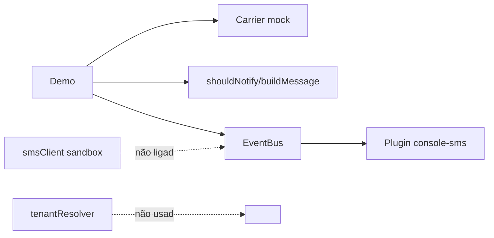

[ATENÇÃO] Initiative Review: Parcel Notify

## TL;DR

- **Propósito (confiança: explícito):** POC para validar se avisos proativos por SMS reduzem os contatos "onde está meu pedido?" (README e `docs/decisions.md`, 2026-08-02).
- **Situação real:** Só existe a regra de notificação (`shouldNotify` e `buildMessage`) e uma demo que imprime SMS no console. A transportadora é mock com status fixos. O cliente de SMS aponta para um sandbox e não é usado pelo fluxo da demo. Nenhum pedido real foi medido.
- **Desperdícios e riscos:**
  - O README marca "Integração real com a transportadora ✅", mas o código é mock.
  - O barramento de eventos, o registro de plugins e o multi-tenant foram construídos antes de a hipótese ser testada.
  - O `tenantResolver` não é chamado por nada.
  - A medição está bloqueada desde 2026-09-01 por falta de contrato com a transportadora.
- **Recomendação principal:** Corrigir o README para refletir a realidade. Destravar a medição com a hipótese principal e o menor caminho de dados reais. Congelar a infraestrutura de plugins e multi-tenant.
- **Decisões para o humano:**
  1. Como obter dados reais de status sem o contrato: exportação manual, planilha ou o portal da transportadora.
  2. Se o multi-tenant e os plugins ficam congelados ou são removidos.
  3. Quem corrige o README.

## Propósito e hipóteses

| Hipótese | Tipo | Status | Evidência |
| --- | --- | --- | --- |
| Clientes avisados por SMS abrem menos chamados | Negócio | Não testada | `docs/decisions.md`: medição com 200 pedidos adiada em 2026-09-01. Não há código de medição de chamados. |
| Há uma API de rastreio da transportadora acessível | Técnica | Não testada | `src/carrier/index.js` exporta o mock. O TODO diz que falta contrato. |
| O provedor de SMS entrega e o custo é viável | Técnica | Não testada | `smsClient.js` aponta para `sandbox.sms-provider.example.test` e o teste usa `fetch` falso. |
| Haverá demanda por outras lojas (multi-tenant) | Negócio | Não testada | Decisão de 2026-08-15, sem evidência de demanda. |
| Haverá outros canais (e-mail, WhatsApp) | Negócio | Não testada | Decisão de 2026-08-10, sem evidência de demanda. |
| Os status relevantes são `out_for_delivery`, `delivered` e `delayed` | Negócio | Em teste | Cobertos por testes unitários, mas sem validação com dados reais. |

## O que existe

| Capability | Implementada | Testada | Demonstrável | Evidência |
| --- | --- | --- | --- | --- |
| Regra de quando avisar e texto da mensagem | Sim | Sim (2 testes) | Sim | `src/core/notifier.js`, `npm test` com 3 de 3 passando |
| Consulta de status na transportadora | Só mock | Não | Sim, com dados fixos | `mockCarrierClient.js` |
| Envio de SMS | Cliente HTTP para sandbox | Sim, com fetch falso | Não | `smsClient.js`. A demo usa um canal `console-sms`, não este cliente. |
| Barramento de eventos (prioridade, middleware, retries) | Sim | Não | Parcial, na demo | `eventBus.js` |
| Registro de plugins | Sim | Não | Parcial, na demo | `pluginRegistry.js` |
| Multi-tenant | Função isolada | Não | Não | `tenantResolver.js` ("Ainda não é chamado por nenhum fluxo") |
| Medição de chamados | Não | Não | Não | Nenhum arquivo |

## Integrações: mock, sandbox ou real

| Integração | Classificação | Evidência | Observação |
| --- | --- | --- | --- |
| Transportadora | **Mock** | `src/carrier/index.js` e `mockCarrierClient.js` | O README diz "real ✅", o que contradiz o código. |
| SMS | **Sandbox** (não ligado ao fluxo) | `smsClient.js`, URL `sandbox...example.test`, comentário "não entrega a celulares reais" | O README diz "Envio de SMS ✅". A demo só imprime no console. A URL `.example.test` provavelmente é um marcador, então nem o sandbox foi confirmado como alcançável. Isso é inferência. |

## Arquitetura frente ao objetivo

Inferência: a arquitetura está superdimensionada para uma POC com um canal e uma loja. O barramento tem prioridade, middlewares e retries, mas o único handler é um `console.log`. O registro de plugins tem versão e capabilities sem uso. O `tenantResolver` está órfão. Não há subdimensionamento de segurança hoje, porque não há dados reais. Quando houver telefones reais, o problema passa a ser LGPD e consentimento.

## Desperdícios, lacunas e riscos

- **Desperdício:**
  - O barramento, o registro de plugins e o multi-tenant não movem a hipótese principal.
  - O `package.json` está na versão 0.3.0 sem nada além de uma demo.
- **Lacuna:**
  - Dados reais de status, ou uma fonte substituta.
  - Um grupo de comparação, ou uma linha de base de chamados, para medir a redução.
  - A ligação do `smsClient` ao fluxo.
  - Uma idempotência e um armazenamento de `lastStatus` (hoje é fixo no código da demo).
- **Risco:**
  - O README enganoso pode levar a decisões erradas sobre o estado da POC. É o principal risco.
  - Dependência de um contrato externo sem plano alternativo.
  - Telefones de clientes sem decisão sobre consentimento ou privacidade.
  - Custo de SMS não estimado.
  - O `emit` com retries pode reenviar SMS duplicados se o handler falhar depois de enviar. É inferência pela leitura do código.

## Recomendações

| Abordagem | Decisão | Por quê |
| --- | --- | --- |
| README (status ✅) | Corrigir | Mock e sandbox aparecem como reais. |
| Regra `notifier` | Manter | Pequena, testada e central à hipótese. |
| Mock da transportadora | Manter, e manter rotulado | Útil para a demo. |
| Cliente SMS sandbox | Corrigir | Ligar ao fluxo e confirmar o sandbox. |
| Barramento de eventos e registro de plugins | Adiar ou simplificar | Um canal não justifica essa estrutura. Uma função chamada diretamente basta. |
| Multi-tenant (`tenantResolver`) | Adiar | Código órfão, sem evidência de demanda, e depende da hipótese principal. |
| Medição com 200 pedidos | Corrigir (destravar) | É o objetivo da POC e hoje está bloqueada. |

## Próximos slices

| # | Slice | Hipótese que valida | Valor | Risco | Esforço |
| --- | --- | --- | --- | --- | --- |
| 1 (primeiro) | Corrigir o README e registrar a linha de base de chamados "onde está meu pedido?" dos últimos 30 dias. Pronto quando o README disser mock/sandbox e houver um número de referência. | Pré-requisito da hipótese de negócio | Alto | Baixo | S |
| 2 | Obter status reais de ~200 pedidos (exportação manual ou portal) e rodar `shouldNotify` offline. Pronto quando houver o percentual de pedidos que dispararia aviso. | Transportadora e status relevantes | Alto | Médio | M |
| 3 | Enviar SMS pelo sandbox a partir do fluxo, com `smsClient` no lugar do `console-sms`. Pronto quando uma chamada ao sandbox for confirmada por log ou resposta. | Provedor de SMS e custo | Médio | Baixo | S |
| 4 | Piloto com clientes reais, com grupo de controle e consentimento. Pronto quando houver a comparação de chamados entre os grupos. | Hipótese principal | Alto | Alto | L |

## Evidências

- **Comandos executados:**
  - `npm test` passou 3 de 3.
  - `npm run demo` imprimiu 3 SMS no console.
  - Leitura dos 14 arquivos versionados.
- **Guarda de não alteração:** `git status --porcelain` vazio e HEAD `f719d2f72ca98c07d73b4d113e472b94d39ea146`, antes e depois. Sem alterações.
- **Fatos verificados:**
  - O código de integração com a transportadora é mock.
  - O `tenantResolver` não é importado por nenhum arquivo.
  - O `smsClient` não é usado pela demo.
  - Os testes passam.
- **Inferências:**
  - A URL `.example.test` é um marcador.
  - Possível duplicação de SMS com os retries.
  - A superengenharia. Os commits têm só uma mensagem, "fixture", então o histórico não ajuda a avaliar o processo.