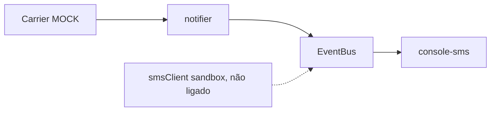

[ATENÇÃO] Initiative Review — Parcel Notify

## TL;DR

- **Propósito (confiança: explícito).** Provar com uma POC que avisos proativos por SMS reduzem os contatos "onde está meu pedido?". A fonte é o README e o `docs/decisions.md` de 2026-08-02.
- **Situação real.** Hoje só funciona uma demo local. Ela lê status fixos de uma transportadora simulada e imprime SMS no console. Nenhum SMS real foi enviado e nenhum pedido real foi medido. O README marca como prontos (✅) itens que o código contradiz.
- **Principais desperdícios e riscos.**
  - O barramento de eventos com prioridade, middlewares e retries, o registro de plugins e o resolvedor de tenant não servem à hipótese.
  - O `tenantResolver` não é chamado por nenhum fluxo.
  - A medição está bloqueada desde 2026-09-01 por falta de contrato com a transportadora, e hoje é 2026-10-18.
  - O README induz a erro.
- **Recomendação principal.** Corrigir o README para refletir a realidade. Destravar a fonte real de status, nem que seja um export manual de status. Fazer a medição com ~200 pedidos antes de investir em plataforma.
- **Decisões para o humano.**
  1. Qual é o caminho para obter status real: contrato, export manual ou outra transportadora?
  2. Congelar o trabalho de plugins e multi-tenant até a hipótese ser medida?
  3. Autorizar a correção do README?

## Propósito e hipóteses

| Hipótese | Tipo | Status | Evidência |
| --- | --- | --- | --- |
| SMS proativo reduz chamados de status de pedido | Negócio | Não testada | `docs/decisions.md`: medição adiada em 09-01. Não há código nem métrica de chamados. |
| Dá para obter o status da entrega de forma automática e confiável | Técnica | Não testada | `src/carrier/index.js` exporta o mock e tem um TODO. |
| O provedor de SMS entrega e aceita o formato | Técnica | Não testada (só teste unitário com fetch falso) | `test/smsClient.test.js`. O `smsClient` não é usado em `demo.js`. |
| As lojas vão querer comprar (multi-tenant) | Negócio | Não testada e prematura | Decisão de 08-15. Fase 2 sem validação da fase 1. |
| Serão necessários vários canais (e-mail, WhatsApp) | Negócio | Não testada | Decisão de 08-10. Nenhuma evidência de demanda. |

## O que existe

| Capability | Implementada | Testada | Demonstrável | Evidência |
| --- | --- | --- | --- | --- |
| Regra de notificação e mensagens | Sim | Sim (2 testes passam) | Sim | `src/core/notifier.js`, `npm test` |
| Consulta de status na transportadora | Só mock | Não | Sim, com dados fixos | `src/carrier/mockCarrierClient.js` |
| Envio de SMS | Cliente HTTP escrito, mas não ligado ao fluxo | Parcial (fetch falso) | Não | `src/sms/smsClient.js`. A demo usa um `console.log`. |
| Barramento de eventos | Sim | Não | Só dentro da demo | `src/infra/eventBus.js` |
| Registro de plugins | Sim | Não | Só dentro da demo | `src/infra/pluginRegistry.js` |
| Multi-tenant | Função isolada | Não | Não | `src/infra/tenantResolver.js` |
| Medição de chamados | Não | Não | Não | Não há código |

## Integrações: mock, sandbox ou real

| Integração | Classificação | Evidência | Observação |
| --- | --- | --- | --- |
| Transportadora (rastreio) | **Mock** | `src/carrier/index.js` e `mockCarrierClient.js` | O README diz "Integração real ✅", o que é falso. |
| SMS | **Sandbox** no código do cliente (URL `sandbox.sms-provider.example.test`). Na demo é só console. | `src/sms/smsClient.js`, `src/demo.js` | O README diz "Envio de SMS ✅". O cliente não entrega a celulares reais e não é chamado pela demo. O host `.example.test` sugere um placeholder. Não verifiquei se existe um sandbox real, pois não usei a rede. |

## Arquitetura frente ao objetivo

Para uma POC de um fluxo único (status → regra → SMS), a arquitetura está sobredimensionada. Isso é inferência. Os fatos são:

- `eventBus.js` tem prioridade, middlewares e retries, mas só um handler é registrado na demo.
- O `pluginRegistry` tem versão e capabilities, mas só o canal "console-sms" é registrado.
- `tenantResolver` não tem chamador.
- Os retries do barramento reenviam o handler inteiro. Se houvesse mais handlers, isso poderia duplicar SMS (inferência).
- Há subdimensionamento onde importa: não existe persistência de `lastStatus` nem de idempotência, e não há métrica de chamados.

## Desperdícios, lacunas e riscos

- **Desperdício:** o barramento, o registro de plugins e o tenantResolver não movem a hipótese. O mesmo vale para a versão 0.3.0 e o README com status inflado.
- **Lacuna:**
  - Fonte real de status.
  - Envio real de SMS ligado ao fluxo.
  - Baseline de chamados e método de medição (grupo de controle?).
  - Persistência do último status.
- **Risco:**
  - O README enganoso pode levar a decisões erradas, como alguém achar que a POC está validada.
  - Dados pessoais (telefone) no SMS exigem consentimento e LGPD, e a conformidade não está tratada.
  - Bloqueio externo sem prazo.
  - Não há como saber o custo de SMS por pedido.

## Recomendações

| Abordagem | Decisão | Por quê |
| --- | --- | --- |
| README de status | Corrigir | Contradiz `src/carrier/index.js` e `smsClient.js`. |
| Regra `notifier` e `smsClient` | Manter | Pequenos, testados e alinhados à hipótese. |
| Barramento de eventos | Simplificar ou adiar | Substituir por uma chamada direta até haver mais de um consumidor. |
| Registro de plugins | Adiar | Há um canal só e a demanda por outros não foi demonstrada. |
| Multi-tenant (`tenantResolver`) | Adiar | Não tem chamador e a fase 2 depende da hipótese. |
| Dependência do contrato com a transportadora | Corrigir | Buscar alternativa, como export manual ou CSV, para medir já. |

## Próximos slices

| # | Slice | Hipótese que valida | Valor | Risco | Esforço |
| --- | --- | --- | --- | --- | --- |
| 1 (primeiro) | Medição manual: baseline de chamados de status e envio de SMS para ~200 pedidos com status de planilha ou export, com grupo de controle. Critério de pronto: comparação de chamados com e sem SMS registrada em `docs/decisions.md`. | SMS reduz chamados | Alto | Médio (LGPD, custo) | M |
| 2 | Ligar `smsClient` ao fluxo no sandbox e depois em produção com poucos números. Critério de pronto: SMS recebido num celular de teste. | Provedor entrega | Médio | Baixo | S |
| 3 | Cliente real da transportadora atrás de `carrierClient`, com persistência do último status. Critério de pronto: status real de um pedido aparece na demo. | Integração viável | Alto | Alto (contrato) | M |
| 4 | Corrigir o README. Critério de pronto: nenhum ✅ sem evidência. | Nenhuma (higiene) | Médio | Nulo | S |

## Evidências

- **Comandos executados.**
  - `npm test`: 3 testes passam, 0 falhas.
  - `npm run demo`: imprime 3 SMS simulados no console.
- **Guarda de não alteração.** `git status --porcelain` veio vazio e HEAD era `21ae83c524fa74ad0c190ef1133c33d51b9ca4b3`, antes e depois. Sem alterações.
- **Fatos verificados.**
  - Conteúdo de todos os arquivos.
  - Resultado de testes e demo.
  - A demo usa o mock de transportadora e um console no lugar do `smsClient`.
  - `tenantResolver` não tem chamador. Eu li os 14 arquivos do repositório e não vi nenhum import dele.
  - Só existe 1 commit ("fixture"), então o histórico não traz informação.
- **Inferências.**
  - Sobredimensionamento.
  - Risco de duplicação por retries.
  - Que o host do sandbox é placeholder.
  - Necessidade de LGPD.
- **Não verificado.** Issues e PRs (não há remoto consultado) e a existência real do provedor de SMS (sem acesso à rede).