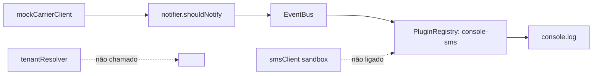

[ATENÇÃO] Initiative Review — Parcel Notify

## TL;DR

- **Propósito (confiança: explícito).** É uma POC para validar se avisos proativos por SMS reduzem os contatos de "onde está meu pedido?". A fonte é `README.md` e `docs/decisions.md`, de 2026-08-02.
- **Situação real.** Só funciona uma simulação local. A regra de "quando avisar" existe e tem teste. O demo usa transportadora simulada (mock) e imprime no console. O cliente de SMS aponta para um sandbox e não é usado no demo. Nenhum SMS real foi enviado, nenhum status real foi lido e nenhum pedido real foi medido.
- **Desperdícios e riscos.**
  - O README marca como ✅ coisas que não existem de fato: transportadora real, plataforma de plugins e multi-tenant pronto.
  - Há infraestrutura prematura (barramento de eventos, registro de plugins, resolver de tenant) sem uso real.
  - A medição, que é o objetivo da POC, está bloqueada desde 2026-09-01 por falta de contrato com a transportadora.
- **Recomendação principal.** Corrigir o README para refletir a realidade. Congelar a infraestrutura de plugins e multi-tenant. Destravar a medição com o menor caminho possível até dados reais de status.
- **Decisões para o humano.**
  1. Corrigir o README agora?
  2. Manter ou remover `eventBus`, `pluginRegistry` e `tenantResolver`?
  3. Como obter status reais sem esperar o contrato: exportação manual (CSV), rastreio público ou outra fonte?
  4. Qual provedor de SMS real usar na medição?

## Propósito e hipóteses

| Hipótese | Tipo | Status | Evidência |
| --- | --- | --- | --- |
| Clientes avisados por SMS abrem menos chamados | Negócio | Não testada | `docs/decisions.md` planejava medir com 200 pedidos reais em setembro. Em 2026-09-01 a medição foi adiada. Não há código nem dado de medição. |
| Avisar só em mudanças relevantes (saiu para entrega, entregue, atrasado) é suficiente | Negócio | Não testada | A regra está em `src/core/notifier.js`. Só há teste unitário, sem validação com clientes. |
| A API da transportadora dá status utilizáveis | Técnica | Não testada | `src/carrier/index.js` exporta o mock e tem um TODO esperando o contrato. |
| O provedor de SMS aceita o formato enviado | Técnica | Não testada | `smsClient.js` aponta para um host `.example.test`, que é placeholder. O teste usa um `fetch` falso. |
| Haverá fase 2 com outras lojas e outros canais | Negócio | Não testada | Aparece em decisions.md (08-10 e 08-15) sem evidência de demanda. |

## O que existe

| Capability | Implementada | Testada | Demonstrável | Evidência |
| --- | --- | --- | --- | --- |
| Regra de notificação e texto das mensagens | Sim | Sim (2 testes passam) | Sim, via `npm run demo` | `src/core/notifier.js`, `test/notifier.test.js` |
| Consulta de status na transportadora | Só mock, com status fixos para p-1, p-2 e p-3 | Não | Só com dados fixos | `src/carrier/mockCarrierClient.js` |
| Envio de SMS | Cliente HTTP escrito, mas não ligado ao fluxo | Sim, com `fetch` falso | Não | `src/sms/smsClient.js`; o demo usa um canal que só faz `console.log` |
| Barramento de eventos (prioridade, middlewares, retries) | Sim | Não | Usado de forma trivial no demo | `src/infra/eventBus.js` |
| Registro de plugins | Sim | Não | Registra um único "canal" de console | `src/infra/pluginRegistry.js` |
| Multi-tenant | Só uma função | Não | Não, nenhum fluxo a chama | `src/infra/tenantResolver.js` |
| Medição de redução de chamados | Não | Não | Não | Não há código nem dado |

## Integrações: mock, sandbox ou real

| Integração | Classificação | Evidência | Observação |
| --- | --- | --- | --- |
| Transportadora (rastreio) | **Mock** | `src/carrier/index.js` reexporta `mockCarrierClient`. O TODO cita o contrato pendente. | O README diz "Integração real ✅", o que contradiz o código. |
| SMS | **Sandbox**, mas fora do fluxo | Comentário e URL padrão em `smsClient.js`. O demo usa `console.log`. | O README diz "Envio de SMS ✅". O envio é sandbox, não entrega a celulares reais e não está ligado ao demo. |
| Canais de e-mail e WhatsApp | Inexistentes | Nenhum arquivo | O README diz "plataforma de plugins ✅", mas existe só o mecanismo, sem nenhum canal. |

## Arquitetura frente ao objetivo

Em uma POC com hipótese por validar, a arquitetura é maior do que o objetivo exige (inferência). Cerca de 3 dos 6 módulos de código não servem à hipótese principal. Isso é overengineering por antecipação de uma fase 2 que nem foi validada.

Pontos de subdimensionamento:
- Não há persistência do último status, e o `lastStatus` está fixo no demo. Sem isso, o mesmo aviso pode ser repetido.
- Não há tratamento de consentimento nem opt-out de SMS.
- Não há coleta de métricas para medir a hipótese.

## Desperdícios, lacunas e riscos

- **Desperdício:**
  - `eventBus` (prioridade, middlewares, retries), `pluginRegistry` e `tenantResolver` não têm teste nem uso real.
  - Existe também a versão 0.3.0 e uma decisão de multi-tenant sem demanda comprovada.
- **Lacuna:**
  - Falta uma fonte real de status.
  - Falta ligar o `smsClient` ao fluxo.
  - Falta persistir o estado.
  - Falta um método para contar os chamados de antes e depois, com grupo de comparação.
- **Risco:**
  - Documentação enganosa. Quem lê o README pode achar que a POC está validada.
  - Retries do `EventBus` repetem o envio de SMS se o handler falhar depois de enviar, o que gera mensagens duplicadas.
  - Há dados pessoais (telefones) e falta de consentimento.
  - A iniciativa depende de um contrato externo sem prazo.
  - O envio real tem custo.

## Recomendações

| Abordagem | Decisão | Por quê |
| --- | --- | --- |
| README com ✅ falsos | Corrigir | Contradiz o código: a transportadora é mock, o SMS é sandbox, não há plugins nem tenant em uso. |
| Regra `notifier` | Manter | É o núcleo, tem teste e é demonstrável. |
| `smsClient` | Corrigir | Ligar ao fluxo, com provedor e URL reais configuráveis. |
| `eventBus` e `pluginRegistry` | Simplificar | Trocar por uma chamada direta ao canal de SMS até haver um segundo canal. |
| `tenantResolver` | Adiar | Não é chamado e a fase 2 não foi validada. |
| Cliente real da transportadora | Corrigir | Hoje bloqueia a medição. Buscar alternativa que não dependa do contrato. |
| Medição com 200 pedidos | Manter, mas definir o método | É o objetivo da POC. Hoje não há plano de medição além da frase em decisions.md. |

## Próximos slices

| # | Slice | Hipótese que valida | Valor | Risco | Esforço |
| --- | --- | --- | --- | --- | --- |
| 1 (primeiro) | Corrigir o README e registrar em decisions.md o estado real e o bloqueio | Nenhuma, mas remove o risco de decisão com informação errada | Médio | Baixo | S |
| 2 | Fonte de status real sem depender do contrato (exportação manual ou rastreio público), com persistência do último status | Técnica: status utilizáveis | Alto | Médio | M |
| 3 | Envio real de SMS a um grupo pequeno de clientes com consentimento, com uma única entrega por mudança de status | Técnica: provedor e entrega funcionam | Alto | Médio (custo e privacidade) | M |
| 4 | Medir chamados de "onde está meu pedido?" nos pedidos avisados contra um grupo de controle | Negócio: redução de chamados | Alto | Médio | M |

Pronto de cada slice:
- Slice 1: o README só marca como feito o que roda.
- Slice 2: o demo lê status de pedidos reais.
- Slice 3: pelo menos N SMS entregues, com log.
- Slice 4: relatório com taxa de contato nos dois grupos.

## Evidências

- **Comandos executados:**
  - `npm test` passou: 3 testes, 3 aprovados, 0 falhas.
  - `npm run demo` imprimiu 3 SMS no console, com status fixos do mock.
  - Li todos os 14 arquivos versionados.
  - O histórico tem um único commit, `a101f81 fixture`. Não há Issues nem PRs para consultar.
- **Guarda de não alteração:** antes, `git status --porcelain` vazio e HEAD `a101f81620ada7b4aef7fd0d73beeaddb171473e`. Depois, o mesmo. Sem alterações.
- **Fatos verificados:**
  - Os resultados dos testes e do demo.
  - A classificação mock/sandbox, com os arquivos citados.
  - O `tenantResolver` não é importado em lugar nenhum. Verifiquei isso na leitura dos arquivos e não rodei busca automática.
  - O `eventBus` e o `pluginRegistry` não têm testes.
- **Inferências:**
  - Overengineering e escopo da fase 2.
  - O risco de SMS duplicado pelos retries.
  - A necessidade de consentimento.
  - A viabilidade das alternativas ao contrato com a transportadora.

Gravar o relatório em arquivo, corrigir o README ou abrir Issues ficam como propostas para sua autorização.